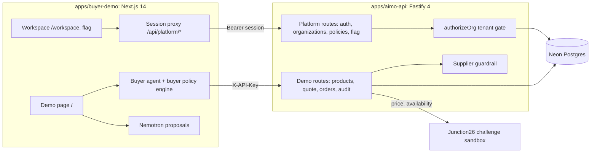
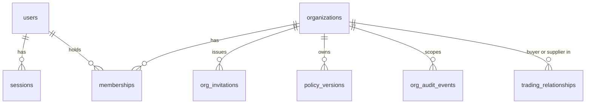

# Architecture

How the repository is put together today, and the decisions behind the first multi-tenant slice.
For what is and is not finished, see IMPLEMENTATION_STATUS.md.

## Components



- **`packages/shared`** is the TypeScript contract both apps import: the demo trade types, and
  now the platform types and the role permission matrix.
- **`apps/aimo-api`** owns the database. It is the only component that authenticates or
  authorizes anything.
- **`apps/buyer-demo`** contains the public demo, the reference buyer agent with its own policy
  engine, the optional LLM calls, and the new organization workspace.
- **`clients/python`** is a second, dependency-free client for the demo contract.

Deployed today: API on Render, web on Vercel, database on Neon.

## Two credential systems, deliberately separate

| | Demo agent | Platform user |
|---|---|---|
| Credential | `X-API-Key` header | Bearer session token |
| Identifies | A seeded demo buyer | A human user |
| Checked by | `requireBuyerAuth` (`src/auth.ts`) | `requireUser` (`src/platform/sessions.ts`) |
| Reaches | `/v1/products`, `/v1/quote`, `/v1/orders`, `/v1/audit`, `/v1/buyers` | `/v1/auth`, `/v1/me`, `/v1/organizations`, `/v1/invitations` |

Neither credential is accepted by the other's routes, and a test asserts both directions. This
is what lets the demo keep working untouched while the platform grows next to it. They converge
later, when agents become scoped credentials owned by an organization (Phase 4).

## Routes

Demo routes, always on:

```text
GET  /health
GET  /v1/products                      search, live price and stock
GET  /v1/products/:id/substitutes
POST /v1/quote                         GET /v1/quote/:id
POST /v1/orders                        GET /v1/orders/:id
POST /v1/orders/:id/approve
GET  /v1/audit/:order_id
GET  /v1/buyers/:id
```

Platform routes, registered only when `AIMO_FEATURE_ORGS=1`:

```text
POST   /v1/auth/signup | /v1/auth/login | /v1/auth/logout
GET    /v1/me                                         user and their organizations
POST   /v1/organizations
GET    /v1/organizations/:orgId                       PATCH to update profile
POST   /v1/organizations/:orgId/onboarding/complete
GET    /v1/organizations/:orgId/members
PATCH  /v1/organizations/:orgId/members/:userId       DELETE to remove
POST   /v1/organizations/:orgId/invitations           GET to list
DELETE /v1/organizations/:orgId/invitations/:id
POST   /v1/invitations/accept
GET    /v1/organizations/:orgId/policy-versions       POST to append a version
GET    /v1/organizations/:orgId/policy-versions/current
GET    /v1/organizations/:orgId/audit-events
```

Web routes: `/` (demo), `/workspace` (flag), `/api/*` demo handlers, `/api/platform/*` (flag).

## Data flow of a demo trade (unchanged)

1. The buyer agent asks the API for a quote. The API fetches live price and availability from
   the sandbox and discloses facts. It applies no buyer rules.
2. The buyer agent runs its own policy engine on the response, in the web app's server process.
3. If the buyer side passes, the agent submits the order. The API runs the supplier guardrail
   and either confirms or holds the order with `approval.owner`.
4. A held order is cleared only by the owning side. Events are appended to `audit_events`.

The LLM is called only before step 1 (to propose products) and after step 4 (to narrate). It
never produces a value that a policy check reads.

## Tenancy model



- **An organization is exactly one side**, `buyer` or `supplier`, and the type cannot change. A
  company that both buys and sells registers two organizations. The alternative (a `both` type)
  would make "whose rules are these?" depend on context, and that question is the product.
- **A membership** is `(org_id, user_id, role)`. A user can belong to several organizations and
  the client chooses one per request through the URL. The server keeps no "active organization"
  state, so there is no stale-context class of bug.
- **Roles are constrained by side.** `buyer_*` roles cannot exist in a supplier organization and
  the reverse (`ROLES_BY_ORG_TYPE`).

### Permission matrix

Defined once in `packages/shared/src/index.ts` (`ROLE_PERMISSIONS`), enforced in
`apps/aimo-api/src/platform/authz.ts`. The UI imports it only to hide controls.

| Permission | owner | admin | purchaser / sales | approver | viewer |
|---|---|---|---|---|---|
| `org:read`, `members:read`, `policy:read` | yes | yes | yes | yes | yes |
| `org:update` | yes | yes | no | no | no |
| `members:manage` | yes | yes, ordinary roles only | no | no | no |
| `policy:write` | yes | yes | no | no | no |
| `audit:read` | yes | yes | no | yes | no |

Additional rules: only an owner can grant, change or remove the owner and admin roles; an
organization always keeps at least one owner. `purchase:*` and `approval:*` permissions are not
defined yet because nothing would enforce them; they arrive with the trade workflow.

### The tenant gate

Every organization-scoped route starts with `authorizeOrg(request, reply, permission)`. It looks
up the caller's membership for the `:orgId` in the URL and returns an `OrgContext`. All later
queries use `ctx.orgId` and `ctx.orgType`, never a value from the request body.

- Not a member: **404**, byte-identical to an organization that does not exist.
- Member without the permission: **403**.

One gate, one place to audit. Secondary ids in a URL (a member, an invitation) are always
matched together with `org_id`, so an id from another tenant is simply not found.

### Policy ownership

`policy_versions` rows are created only through
`POST /v1/organizations/:orgId/policy-versions`. The side is the organization's type read from
the database. A body that names the other side is rejected with `policy_side_mismatch`, and each
side's rules have a strict schema, so supplier fields cannot ride along in buyer rules.

There is no route through which a principal of one organization can address another
organization's policy. When trading relationships arrive, a supplier will set per-buyer terms on
the relationship record it owns; it will still not write to the buyer's policy.

Versions are append-only. "Current" is the highest version whose `effective_from` has passed, so
a change can be scheduled. Backdating is refused: a version must not claim to have governed
decisions made before it existed.

## Decisions and tradeoffs

**Extend the existing API instead of a new service.** One Fastify app, one database, new routes
behind a flag. Splitting policy evaluation into separately hosted services per tenant is what
the product eventually implies, but doing it before there is a second supplier would be
speculation. PROJECT.md allows a shared hosted service for v1 as long as configuration is
tenant-owned, versioned and separately authorized, which is what this slice sets up.

**First-party auth, as a stopgap.** PROJECT.md asks to reuse the existing auth and not add a
second stack. There was no human authentication to reuse, only the agent API-key table. The
options were a managed provider (Neon Auth is the natural fit for this database) or a minimal
built-in one. A managed provider needs provisioning on the hosted project and real redirect
domains, which could not be done or verified from a code change alone. So this slice uses
`node:crypto` scrypt and opaque server-side sessions, with no new dependency, and keeps the
seam narrow: everything downstream depends only on `request.user`, set by `requireUser`. Swapping
the provider means replacing `sessions.ts`, `passwords.ts` and `routes/platformAuth.ts`. **This
should be replaced before the pilot**, because email verification, recovery and MFA are not
things to hand-build.

**Session token in an httpOnly cookie, via a proxy.** The browser talks to
`/api/platform/*` on the web origin. That route holds the token in an httpOnly, SameSite=Lax
cookie and forwards it as a bearer token. Page scripts never see the token, the API needs no
CORS, and the proxy forwards only platform path roots, so it cannot be used to reach the demo's
order routes. Writes also require a same-origin `Origin` header.

**Single-statement atomicity.** The Neon HTTP driver has no interactive transactions. Creating
an organization with its owner, accepting an invitation, and every change with its audit row are
each one SQL statement using data-modifying CTEs (`withAudit` in `src/platform/audit.ts`). The
alternative was switching to the WebSocket driver for real transactions; that changes how the
service connects everywhere and was not needed yet. It will be when order submission needs
multi-step consistency.

**PGlite for tests.** Tests run the real migrations and real SQL on an in-process Postgres, with
no network, Docker or hosted database. It is the one new dependency (dev only). Mocking the
query layer would have tested the mocks, not the tenant filters.

**Database rules for immutability.** `CREATE RULE ... DO INSTEAD NOTHING` on update and delete
is a one-statement, idempotent guard that fits the migration runner. It fails silently rather
than raising, and an owner can drop it. It is defense in depth, not tamper evidence.

**Environment boundary by refusal.** `AIMO_ENV=production` stops the process at startup. There
is no production connector, so the safest meaning of "production" is "not available". The value
becomes meaningful when Phase 2's launch gates exist.

## External integrations

| Integration | Used for | Notes |
|---|---|---|
| Junction26 sandbox (`junction26.valioaimo.fi`) | Live price and availability | Challenge sandbox, not a supplier feed. Key is server-side only. No order endpoint. |
| Neon Postgres | All persistence | HTTP driver, one statement per request |
| NVIDIA Nemotron on Verda | Proposals and explanations | Optional. OpenAI-compatible endpoint. Never a decision input. |
| Render, Vercel | Hosting | Not changed by this slice |

## Configuration

API (`apps/aimo-api/.env`):

| Variable | Default | Meaning |
|---|---|---|
| `AIMO_ENV` | `sandbox` | `production` is refused |
| `AIMO_FEATURE_ORGS` | off | Registers the platform routes |
| `DATABASE_URL` | required | Neon connection string |
| `AIMO_UPSTREAM_API_KEY`, `AIMO_BUYER_API_KEYS` | none | Demo only. Missing values log a warning. |

Web (`apps/buyer-demo/.env`):

| Variable | Default | Meaning |
|---|---|---|
| `NEXT_PUBLIC_AIMO_FEATURE_ORGS` | off | Enables `/workspace` and `/api/platform/*` |
| `AIMO_API_BASE_URL` | `http://localhost:8080` | Where the API runs |

Both flags must be on for the workspace to work.
